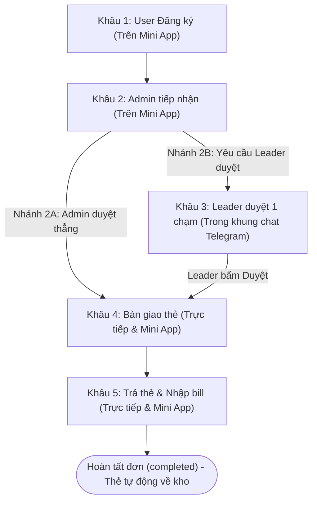

# KỊCH BẢN KIỂM THỬ TOÀN BỘ CÁC LUỒNG HỆ THỐNG QUẢN LÝ THẺ TAXI
## (ĐẶC TẢ CHI TIẾT GIAO DIỆN NGƯỜI DÙNG & TƯƠNG TÁC KHUNG CHAT TELEGRAM)

> **Tài liệu tham chiếu:** [DU_AN_QUAN_LY_THE_TAXI.md](file:///d:/Project_VCC/Quan%20ly%20the%20taxi/DU_AN_QUAN_LY_THE_TAXI.md)  
> **File Excel đi kèm:** [KICH_BAN_TEST_LUONG_TAXI.xlsx](file:///d:/Project_VCC/Quan%20ly%20the%20taxi/KICH_BAN_TEST_LUONG_TAXI.xlsx)  
> **Quy trình chuẩn 5 khâu:** Khâu 1: User Đăng ký -> Khâu 2: Admin duyệt (Duyệt thẳng hoặc Yêu cầu Leader) -> Khâu 3: Leader duyệt (Nếu Admin yêu cầu) -> Khâu 4: Bàn giao thẻ -> Khâu 5: Trả thẻ & Nhập bill.

---

## PHẦN 1: TỔNG QUAN HỆ THỐNG LUỒNG



### Danh mục 7 luồng kiểm thử:
1. **FLOW-01 (Luồng chính 5 khâu):** Mượn - Cấp - Trả thẻ (Admin duyệt thẳng HOẶC Yêu cầu Leader duyệt).
2. **FLOW-02 (Luồng hết thẻ):** Kho 0 thẻ sẵn sàng -> Đưa vào Danh sách chờ (Waitlist) -> Cấp bù khi thẻ về kho.
3. **FLOW-03 (Luồng từ chối/hủy):** Admin từ chối ở Khâu 2 / Leader từ chối ở Khâu 3 / User tự hủy ở Khâu 1.
4. **FLOW-04 (Luồng thiếu hóa đơn):** Thu thẻ vào kho trước, nợ bill -> Đơn ở trạng thái *Thiếu dữ liệu* -> Bổ sung bill sau.
5. **FLOW-05 (Luồng vượt hạn mức):** Chi phí bill > 500k -> HR thẩm định và bấm *Accept (Duyệt chi)* hoặc *Reject (Từ chối)*.
6. **FLOW-06 (Luồng giải phóng thẻ theo Timeline):** User quá 90p không đến nhận -> HR/Admin bấm giải phóng thẻ về kho.
7. **FLOW-07 (Luồng Admin xin nhường thẻ qua Telegram):** Admin bấm "Xin nhường thẻ" -> User nhận tin nhắn Telegram kèm 2 nút [Đồng ý] / [Không nhường] -> Xác nhận 1 chạm trực tiếp trên Telegram.

---

## PHẦN 2: WALKTHROUGH CHI TIẾT TỪNG KHÂU (GIAO DIỆN NGƯỜI DÙNG & KHUNG CHAT TELEGRAM)

---

### KHÂU 1: USER ĐĂNG KÝ MƯỢN THẺ

#### 1. Màn hình người dùng (User thấy gì trên Telegram Mini App):
* User mở Telegram Mini App (Tab **Đăng ký**).
* **Phía trên cùng:** Thẻ trạng thái kho: `🟢 Tình trạng kho thẻ: Còn 3 thẻ sẵn sàng`.
* **Khung thông tin nhân sự:** Tên (`Nguyễn Văn A`), Mã NV (`NV-1024`), Bộ phận (`Phòng Kinh Doanh`) được điền sẵn và khóa mờ (read-only).
* **Form nhập liệu:**
  * Ô 1: *Mục đích dùng thẻ (\*):* Gõ `"Họp xúc tiến mở rộng thị trường tại Sở Kế hoạch Đầu tư"`.
  * Ô 2: *Địa điểm gặp/di chuyển (\*):* Gõ `"Sở Kế hoạch & Đầu tư, Hoàng Hoa Thám"`.
  * Ô 3: *Nhãn khách:* Bấm tag nhanh chọn `[Cơ quan nhà nước]`.
* **Nút bấm:** Bấm nút **`[ 🚖 Gửi yêu cầu mượn thẻ ]`** (màu xanh dương).

#### 2. Hệ thống làm gì với giao diện và Telegram của User:
* **Trên màn hình Mini App của User:**
  * Xuất hiện thông báo màu xanh lá: `✅ Gửi yêu cầu mượn thẻ thành công! Mã đơn: REQ-2026-101`.
  * Hệ thống tự động chuyển User sang Tab **"Yêu cầu của tôi"**, thấy đơn hàng REQ-2026-101 hiển thị với badge màu vàng: `🟡 Chờ Admin duyệt`.
* **Trên khung chat Telegram riêng của User:**
  * Bot `@TaxicardBot` gửi 1 tin nhắn thông báo:
    ```
    🚕 TAXICARD NOTIFICATION BOT
    Yêu cầu mượn thẻ REQ-2026-101 của bạn đã được gửi thành công.
    Hệ thống đang chuyển tới Admin Ban Quản Trị để tiếp nhận và xử lý.
    ```

---

### KHÂU 2: ADMIN TIẾP NHẬN & PHÊ DUYỆT (MINI APP ADMIN)

#### 1. Màn hình người dùng (Admin thấy gì trên Telegram Mini App):
* Admin (anh Lê Hoàng Nam) mở Mini App -> Chọn Tab **"Hàng chờ duyệt"**.
* Tại cột **Chờ duyệt**, xuất hiện thẻ yêu cầu của Nguyễn Văn A:
  * Mã đơn: `REQ-2026-101` | Người tạo: `Nguyễn Văn A (Phòng Kinh Doanh)`.
  * Lộ trình: `Sở Kế hoạch & Đầu tư, Hoàng Hoa Thám` | Khách: `Cơ quan nhà nước`.
  * Hệ thống tự động đề xuất thẻ kho: `Mã thẻ dự kiến: TAXI-01`.
* **Các nút bấm hành động hiển thị trên thẻ đơn:**
  * Nút xanh lá: **`[ ✅ Duyệt cấp thẻ ngay ]`** *(Duyệt thẳng)*.
  * Nút xanh tím: **`[ 👤 Yêu cầu Leader duyệt ]`** *(Chuyển Leader phòng ban thẩm định)*.
  * Nút đỏ: **`[ ❌ Từ chối ]`**.

#### 2. Hệ thống làm gì khi Admin bấm:
* **Trường hợp 2A — Admin bấm `[ Duyệt cấp thẻ ngay ]` (Duyệt thẳng):**
  * Trên màn hình Admin: Thẻ đơn nhảy ngay sang cột **"Chờ bàn giao thẻ"**. Thẻ `TAXI-01` chuyển sang trạng thái `reserved` (Đã khóa giữ).
  * Chuyển thẳng sang **Khâu 4** (Bỏ qua bước Leader).
* **Trường hợp 2B — Admin bấm `[ Yêu cầu Leader duyệt ]`:**
  * Trên màn hình Admin: Thẻ đơn đổi nhãn thành: `🕒 Đang chờ Leader Bích Trần duyệt`.
  * Hệ thống tự động kích hoạt Webhook gửi tin nhắn Bot Telegram sang cho Leader Bích Trần (Chuyển sang **Khâu 3**).

---

### KHÂU 3: LEADER DUYỆT (DUYỆT 1 CHẠM TRỰC TIẾP TRÊN KHUNG CHAT TELEGRAM)

#### 1. Màn hình người dùng (Leader thấy gì trên Telegram):
* Leader (chị Trần Thị Bích) nhận được tin nhắn riêng từ bot `@TaxicardBot`.
* **Leader KHÔNG CẦN mở Mini App**, trong cửa sổ chat Telegram xuất hiện tin nhắn kèm nút bấm tương tác:

```text
┌──────────────────────────────────────────────────────────────┐
│ 🚕 TAXICARD NOTIFICATION BOT                  Hôm nay, 11:45 │
│                                                              │
│ 🔔 Yêu cầu mượn thẻ taxi cần Leader duyệt:                   │
│ • Mã yêu cầu: REQ-2026-101                                   │
│ • Nhân sự: Nguyễn Văn A (NV-1024 - Phòng Kinh Doanh)         │
│ • Mục đích: Họp xúc tiến mở rộng thị trường tại Sở KH&ĐT     │
│ • Điểm đến: Sở Kế hoạch & Đầu tư, Hoàng Hoa Thám             │
│ • Khách: Cơ quan nhà nước                                    │
├──────────────────────────────┬───────────────────────────────┤
│         [ ✅ Duyệt ]         │         [ ❌ Từ chối ]        │
├──────────────────────────────┴───────────────────────────────┤
│             [ 📱 Mở app để xem chi tiết / ghi chú ]          │
└──────────────────────────────────────────────────────────────┘
```

#### 2. Thao tác của Leader:
* Leader đọc lướt nội dung ngay trên khung chat Telegram.
* Leader dùng ngón tay bấm thẳng nút **`[ ✅ Duyệt ]`** (màu xanh lá) ngay dưới tin nhắn.
*(Chỉ bấm nút `[📱 Mở app]` nếu cần kiểm tra lịch sử chuyến đi cũ hoặc ghi chú dài)*.

#### 3. Hệ thống làm gì với khung chat Telegram của Leader sau khi bấm:
* Tức thì trong 0.3 giây, Telegram hiện thông báo pop-up toast trên đỉnh màn hình: *"Đã duyệt yêu cầu REQ-2026-101 thành công!"*.
* **Chính tin nhắn cũ tự động đổi nội dung (`editMessageText`), các nút bấm biến mất hoàn toàn:**

```text
┌──────────────────────────────────────────────────────────────┐
│ 🚕 TAXICARD NOTIFICATION BOT                  Hôm nay, 11:46 │
│                                                              │
│ 🔔 Yêu cầu mượn thẻ taxi: REQ-2026-101                       │
│ • Nhân sự: Nguyễn Văn A (NV-1024 - Phòng Kinh Doanh)         │
│ • Điểm đến: Sở Kế hoạch & Đầu tư, Hoàng Hoa Thám             │
│ ──────────────────────────────────────────────────────────── │
│ ✅ ĐÃ DUYỆT TRỰC TIẾP TRÊN TELEGRAM                          │
│ • Người duyệt: Leader Trần Thị Bích lúc 11:46 Hôm nay        │
│ • Trạng thái: Đã chuyển Hành chính chuẩn bị & bàn giao thẻ    │
└──────────────────────────────────────────────────────────────┘
```
* Khung chat Telegram của Leader dừng tại đây, hoàn tất trong 1 giây mà không phải tải trang web hay mở ứng dụng nào.

---

### KHÂU 4: BÀN GIAO THẺ VẬT LÝ TẠI PHÒNG HÀNH CHÍNH

#### 1. Hệ thống gửi thông báo cho User:
* Điện thoại của User (Nguyễn Văn A) ting-ting nhận tin nhắn từ `@TaxicardBot`:
  ```
  🚕 TAXICARD NOTIFICATION BOT
  Yêu cầu REQ-2026-101 của bạn đã được phê duyệt!
  Mã thẻ chuẩn bị: TAXI-01.
  Mời bạn đến gặp chị Hà (Phòng Hành chính Nhân sự) để nhận thẻ vật lý.
  ```
* Màn hình Mini App của User đổi trạng thái đơn sang màu xanh dương: `🔵 Đã duyệt - Mời nhận thẻ TAXI-01`.

#### 2. Màn hình người dùng (HR thấy gì trên Mini App):
* User đến bàn Hành chính. Chị Phạm Thu Hà mở Mini App -> Tab **"Chờ bàn giao thẻ"**.
* Thấy đơn của Nguyễn Văn A, mã thẻ dự kiến `TAXI-01`.
* Kèm nút bấm to rõ ràng: **`[ 🚖 Xác nhận đã giao thẻ cho NV ]`** (màu xanh lá).

#### 3. Thao tác và phản hồi của hệ thống:
1. Chị Hà mở ngăn kéo lấy thẻ nhựa `TAXI-01` đưa cho anh A.
2. Chị Hà bấm nút **`[ Xác nhận đã giao thẻ cho NV ]`** trên Mini App.
3. **Phản hồi hệ thống:**
   * Thẻ đơn trên màn hình HR biến mất khỏi tab Chờ giao, chuyển sang tab **"Đang giữ thẻ & Chờ bill"**.
   * Thẻ `TAXI-01` chuyển sang trạng thái `in_use` (Đang sử dụng ngoài kho).
   * **Nút hoàn tác của Leader lập tức bị KHÓA CỨNG VĨNH VIỄN** (không cho rút lại quyết định khi thẻ đã giao).
   * Màn hình Mini App của User chuyển sang màu tím: `🟣 Đang giữ thẻ TAXI-01 (Chúc bạn có chuyến đi an toàn!)`.
   * Bot Telegram gửi tin nhắn dặn dò User: *"Bạn đã nhận thẻ TAXI-01 lúc 13:30. Vui lòng giữ lại hóa đơn cước xe để nộp lại khi về"*.

#### 4. Nhánh xử lý nếu User CHƯA ĐẾN NHẬN THẺ (Cảnh báo theo Timeline trước khi giải phóng thẻ):
Nếu thẻ đã được duyệt và giữ sẵn ở phòng Hành chính nhưng User chưa đến lấy, hệ thống kích hoạt **quy trình cảnh báo 3 mốc thời gian**:
* **Mốc 0 (Ngay khi duyệt):** Bot gửi tin nhắn mời User đến phòng Hành chính nhận thẻ.
* **Timeline 1 — Sau 30 phút chưa đến nhận:**
  * Bot Telegram tự động gửi tin **Nhắc nhở lần 1**:
    > *"⏰ Nhắc nhở lần 1: Thẻ TAXI-01 của bạn đã sẵn sàng tại phòng Hành chính được 30 phút. Vui lòng đến nhận để kịp giờ di chuyển."*
* **Timeline 2 — Sau 60 phút (1 tiếng) chưa đến nhận:**
  * Bot Telegram tự động gửi tin **Cảnh báo khẩn lần 2**:
    > *"⚠️ Cảnh báo lần 2: Đã 60 phút trôi qua bạn chưa đến nhận thẻ. Bạn còn 30 phút nữa để đến nhận trước khi thẻ bị giải phóng về kho để nhường cho người khác!"*
  * Trên Mini App của User: Thẻ đơn nhấp nháy cảnh báo đỏ sắp hết hạn giữ thẻ.
* **Timeline 3 — Quá 90 phút (1 tiếng rưỡi) vẫn không đến nhận:**
  * HR bấm nút **[Giải phóng thẻ về kho]** (hoặc hệ thống tự động quét giải phóng).
  * Thẻ `TAXI-01` ngay lập tức trở về trạng thái `available` trong kho sẵn sàng cho người khác mượn.
  * Bot Telegram gửi tin nhắn thông báo hủy:
    > *"❌ Hết hạn giữ thẻ: Do bạn không đến nhận theo các mốc thông báo (quá 90 phút), thẻ TAXI-01 đã được giải phóng về kho. Yêu cầu REQ-2026-101 đã bị hủy."*
  * Đơn chuyển sang trạng thái kết thúc: `card_released` (Thẻ đã giải phóng).

#### 5. Nhánh xử lý: ADMIN BẤM NÚT "XIN NHƯỜNG THẺ" (FLOW-07)
Khi phát sinh ca công tác khẩn cấp (VIP, công tác đột xuất cấp lãnh đạo) mà kho hết thẻ:
1. **Thao tác Admin trên Mini App:**
   * Admin mở Tab **Chờ bàn giao**, tìm đơn của Nguyễn Văn A đang giữ thẻ `TAXI-01`.
   * Bấm nút **`[ 🙋 Xin nhường thẻ ]`** (màu xanh dương).
   * Nhập lý do (VD: *"Có đoàn khách VIP phát sinh đột xuất cần xe đón tại sân bay"*).
   * Bấm **Gửi tin nhắn Telegram**.
   * Hệ thống ghi nhận trạng thái: `⏳ Đã gửi tin nhắn xin nhường thẻ qua Telegram - Chờ NV xác nhận...`.
2. **User nhận tin nhắn và xác nhận 1 chạm trên Telegram:**
   * Bot Telegram gửi tin nhắn kèm 2 nút Inline Keyboard tới Telegram của Nguyễn Văn A:
     ```
     ⚠️ YÊU CẦU XIN NHƯỜNG THẺ TAXI
     Chào bạn Nguyễn Văn A,
     Đơn mượn thẻ REQ-2026-101 của bạn hiện đang giữ thẻ TAXI-01.
     Ban Quản trị / Admin đang có trường hợp cần đi gấp và xin bạn hỗ trợ nhường thẻ này.
     📝 Lý do: "Có đoàn khách VIP phát sinh đột xuất cần xe đón tại sân bay"

     Bạn vui lòng bấm nút xác nhận trực tiếp bên dưới:
     [ ✅ Đồng ý nhường thẻ ]    [ ❌ Không nhường (Tôi vẫn cần đi) ]
     ```
3. **Phản hồi của hệ thống theo lựa chọn của User:**
   * **Trường hợp A — User bấm `[ ✅ Đồng ý nhường thẻ ]`:**
     * Tin nhắn Telegram của User lập tức cập nhật: *"✅ Bạn đã xác nhận nhường thẻ TAXI-01 thành công. Cảm ơn bạn đã hỗ trợ!"*
     * Thẻ `TAXI-01` ngay lập tức trở về kho `available` (sẵn sàng cấp cho ca khẩn cấp).
     * Đơn REQ-2026-101 chuyển sang trạng thái: `cancelled` *(Ghi chú: Đã nhường thẻ cho ca khẩn)*.
     * Bot gửi tin báo Admin: *"Nguyễn Văn A đã đồng ý nhường thẻ TAXI-01. Thẻ đã sẵn sàng cấp phát!"*
   * **Trường hợp B — User bấm `[ ❌ Không nhường (Tôi vẫn cần đi) ]`:**
     * Tin nhắn Telegram của User lập tức cập nhật: *"👌 Bạn đã từ chối nhường thẻ. Thẻ TAXI-01 vẫn tiếp tục được giữ cho bạn theo lịch hẹn."*
     * Thẻ `TAXI-01` vẫn giữ nguyên trạng thái `reserved` cho User A.
     * Bot gửi tin báo Admin: *"Nguyễn Văn A từ chối nhường thẻ (vẫn cần đi theo lịch). Thẻ được giữ nguyên."*

---

### KHÂU 5: TRẢ THẺ VẬT LÝ & NHẬP HÓA ĐƠN (BILL)

#### 1. Thao tác gặp mặt trực tiếp:
* User đi taxi công tác về công ty, đến bàn gặp chị Hà, đưa lại thẻ nhựa `TAXI-01` và tờ hóa đơn giấy cước taxi (hoặc gửi ảnh hóa đơn điện tử).

#### 2. Màn hình người dùng (HR thao tác trên Mini App):
* Chị Hà mở Mini App -> Tab **"Đang mượn thẻ"** -> Bấm nút **`[ 🧾 Thu hồi thẻ & Nhập bill ]`** tại dòng đơn của Nguyễn Văn A.
* Một cửa sổ Modal Popup hiện lên giữa màn hình:
  * **Tình trạng thẻ vật lý:** Chọn nút tròn `[ ● Tốt - Sẵn sàng dùng tiếp ]`.
  * **Điểm đón:** Nhập `"Trụ sở công ty, 219 Trung Kính"`.
  * **Điểm trả:** Nhập `"Sở Kế hoạch & Đầu tư, Hoàng Hoa Thám"`.
  * **Số tiền thực tế:** Nhập `"245.000"` VNĐ *(hoặc bấm nút tải ảnh để camera/OCR tự điền số tiền)*.
  * *(Nếu User quên lấy bill: Tích chọn checkbox: ☑ Chưa có hóa đơn / Thiếu dữ liệu chi phí)*.
* Bấm nút: **`[ 💾 Lưu & Hoàn tất lượt dùng thẻ ]`** (màu xanh lá).

#### 3. Hệ thống làm gì sau khi bấm Lưu:
* Thẻ nhựa `TAXI-01` lập tức được cộng ngược lại kho thẻ sẵn sàng (Số thẻ trống trong kho tăng từ 2 -> 3 thẻ).
* Đơn hàng chuyển sang trạng thái hoàn tất: `🟢 completed`.
* **Bot Telegram tự động gửi tin nhắn báo cho User:**
  ```
  🚕 TAXICARD NOTIFICATION BOT
  Chuyến đi REQ-2026-101 đã hoàn tất!
  • Thẻ TAXI-01: Đã thu hồi an toàn vào kho.
  • Chi phí ghi nhận: 245.000 VNĐ.
  Cảm ơn bạn đã hoàn thành đúng quy định sử dụng thẻ taxi của công ty!
  ```

---

## PHẦN 3: BẢNG MA TRẬN TỔNG HỢP GIAO DIỆN & TƯƠNG TÁC THEO TỪNG VAI TRÒ

| Vai Trò | Màn Hình / Giao Diện Thấy Gì? | Nút Bấm Thao Tác | Hệ Thống Phản Hồi Gì Trên UI? | Bot Telegram Gửi Tin Nhắn Gì? |
| :--- | :--- | :--- | :--- | :--- |
| **Nhân sự (User)** | Form đăng ký mượn thẻ (Mini App) | `[ Gửi yêu cầu mượn thẻ ]` | Hiện banner xanh `Gửi thành công! Mã REQ-xxx`, chuyển sang tab Yêu cầu của tôi. | Gửi tin nhắn chat riêng: Thông báo mã đơn đã gửi, thông báo khi được duyệt, thông báo mời nhận thẻ. |
| **Admin** | Hàng chờ duyệt đơn (Mini App Admin) | `[ Duyệt cấp thẻ ngay ]`<br/>hoặc `[ Yêu cầu Leader duyệt ]` | Đơn tự nhảy cột: Hoặc sang cột Chờ giao thẻ (nhánh 2A), hoặc hiện badge Đang chờ Leader (nhánh 2B). | Không cần nhận tin rác; quản lý tập trung trên dashboard Mini App. |
| **Leader** | **Bong bóng chat Telegram riêng** (kèm 3 nút bấm) | **Bấm nút inline ngay trên chat Telegram:**<br/>`[ ✅ Duyệt ]` hoặc `[ ❌ Từ chối ]` | **Chính bong bóng chat tự động sửa text** thành `✅ ĐÃ DUYỆT lúc 11:46`, các nút bấm tự ẩn đi. Không cần mở Mini App. | Toàn bộ diễn ra trên khung chat Telegram của Leader. |
| **HR / Điều phối** | Danh sách chờ giao thẻ & Modal thu thẻ/bill (Mini App) | `[ Xác nhận đã giao thẻ ]`<br/>`[ Thu hồi thẻ & Nhập bill ]` | Đơn chuyển trạng thái tức thì; số lượng thẻ trống trong kho tự động tăng/giảm theo thời gian thực. | Bot tự động thay mặt HR gửi thông báo mời nhận thẻ hoặc xác nhận hoàn tất chuyến đi cho User. |
