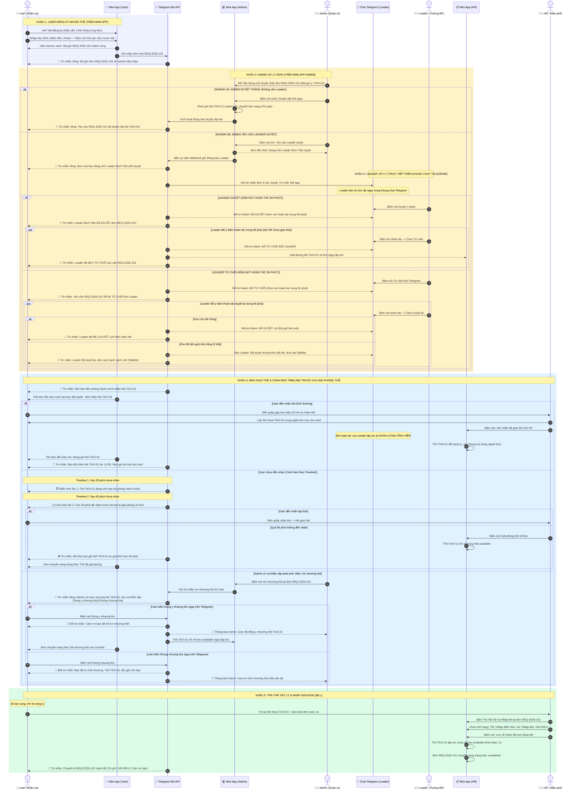

# SƠ ĐỒ LUỒNG NGHIỆP VỤ & TƯƠNG TÁC GIAO DIỆN (MERMAID)

Tài liệu này chứa các khối mã Mermaid chuẩn 100%, **đã được tối ưu để tương thích hoàn toàn với Draw.io, Mermaid Live Editor, Notion, Obsidian, GitHub**.
* Đã loại bỏ toàn bộ ngoặc lồng `[` `]` và ký tự đặc biệt gây lỗi vỡ khung trong Draw.io.
* **Cơ chế Hoàn tác 90 phút của Leader:** Tự động fallback sang Waitlist nếu kho hết thẻ trống.
* **Timeline Cảnh báo trước khi giải phóng thẻ:** Mốc 30 phút (nhắc nhở lần 1) -> Mốc 60 phút (cảnh báo lần 2) -> Mốc 90 phút (hủy giữ thẻ và giải phóng về kho).

---

## 1. SƠ ĐỒ LƯU ĐỒ KHỐI VẬN HÀNH (FLOWCHART - DÁN VÀO DRAW.IO HOẶC MERMAID LIVE)

```mermaid
flowchart TD
    START([Bắt đầu: User có nhu cầu đi taxi]) --> K1_FORM

    %% Khâu 1: User Đăng ký
    K1_FORM["Khâu 1: User mở Mini App<br/>Nhập Mục đích, Điểm đến, Khách"]
    K1_FORM --> K1_SUBMIT["User bấm nút: Gửi yêu cầu mượn thẻ"]
    K1_SUBMIT --> K1_NOTIF["Hệ thống tạo đơn REQ mới<br/>Bot Telegram gửi tin xác nhận cho User"]

    %% Khâu 2: Admin duyệt
    K1_NOTIF --> K2_OPEN["Khâu 2: Admin mở Mini App<br/>Vào Hàng chờ duyệt xem đơn"]
    K2_OPEN --> K2_CHECK{"Kho còn thẻ<br/>sẵn sàng không?"}
    
    K2_CHECK -- "Hết thẻ" --> FLOW_WAITLIST["FLOW-02: Đưa vào Danh sách chờ Waitlist<br/>Bot gửi tin báo User chờ thẻ"]
    K2_CHECK -- "Còn thẻ" --> K2_DECIDE{"Admin chọn phương án?"}

    K2_DECIDE -- "Không hợp lệ" --> FLOW_REJECT_AD["Admin bấm nút: Từ chối yêu cầu"]
    FLOW_REJECT_AD --> NOTIF_REJECT_AD["Bot Telegram nhắn User:<br/>Đơn bị Admin từ chối kèm lý do"]
    NOTIF_REJECT_AD --> END_REJECT([Kết thúc đơn: Bị từ chối])

    K2_DECIDE -- "Nhánh 2A: Duyệt thẳng" --> K2_DIRECT["Admin bấm nút: Duyệt cấp thẻ ngay<br/>Hệ thống tự động khóa giữ thẻ TAXI-01"]
    K2_DECIDE -- "Nhánh 2B: Cần Leader duyệt" --> K2_REQUEST["Admin bấm nút: Yêu cầu Leader duyệt<br/>Bot tự động gửi tin nhắn sang Leader"]

    %% Khâu 3: Leader duyệt & Cơ chế hoàn tác 90 phút
    K2_REQUEST --> K3_MSG["Khâu 3: Leader nhận tin nhắn trên Telegram chat<br/>Có 3 nút bấm: Duyệt, Từ chối, Mở app"]
    K3_MSG --> K3_ACTION{"Leader chọn thao tác<br/>ngay trên Telegram?"}

    %% Nhánh 3A: Leader Từ chối
    K3_ACTION -- "Bấm nút Từ chối" --> FLOW_REJECT_LD["Leader bấm nút: Từ chối trên Telegram<br/>Mở cửa sổ hoàn tác trong 90 phút"]
    FLOW_REJECT_LD --> NOTIF_REJECT_LD["Bot Telegram nhắn User:<br/>Đơn bị Leader từ chối kèm lý do"]
    
    FLOW_REJECT_LD --> K3_UNDO_REJECT{"Trong 90 phút và HR chưa giao thẻ:<br/>Leader có đổi ý bấm Hoàn tác không?"}
    K3_UNDO_REJECT -- "Hết 90 phút hoặc giữ nguyên" --> END_REJECT
    K3_UNDO_REJECT -- "Leader đổi ý bấm Hoàn tác duyệt lại" --> K3_CHECK_CARD{"Kiểm tra kho thẻ lúc này<br/>còn thẻ sẵn sàng không?"}
    
    K3_CHECK_CARD -- "Kho còn thẻ trống" --> K3_APPROVE
    K3_CHECK_CARD -- "Kho đã hết sạch thẻ trống" --> FLOW_WAITLIST_UNDO["Tự động chuyển vào Danh sách chờ Waitlist<br/>Bot báo User và Leader: Đang chờ thẻ về kho"]
    FLOW_WAITLIST_UNDO --> FINISH_ALL

    %% Nhánh 3B: Leader Duyệt
    K3_ACTION -- "Bấm nút Mở app" --> K3_APP["Mở Mini App xem chi tiết và ghi chú"]
    K3_APP --> K3_APPROVE["Xác nhận duyệt đơn"]
    K3_ACTION -- "Bấm nút Duyệt 1 chạm" --> K3_APPROVE

    K3_APPROVE --> K3_APPROVED_STATE["Đã duyệt - Mở cửa sổ hoàn tác 90 phút<br/>Tự động khóa giữ thẻ kho TAXI-01"]
    K3_APPROVED_STATE --> K3_UNDO_APPROVE{"Trong 90 phút và HR chưa giao thẻ:<br/>Leader có đổi ý bấm Hoàn tác không?"}
    
    K3_UNDO_APPROVE -- "Leader đổi ý bấm Hoàn tác từ chối" --> K3_RELEASE_CARD["Giải phóng thẻ TAXI-01 về kho ngay<br/>Chuyển đơn thành Bị từ chối"]
    K3_RELEASE_CARD --> NOTIF_REJECT_LD
    
    K3_UNDO_APPROVE -- "Giữ nguyên quyết định duyệt" --> NOTIF_LEADER_OK["Bot Telegram nhắn User:<br/>Leader đã duyệt - Chuyển Hành chính chuẩn bị thẻ"]

    %% Khâu 4: Bàn giao thẻ & Timeline cảnh báo
    K2_DIRECT --> K4_NOTIF["Khâu 4: Bot gửi tin nhắn cho User<br/>Mời đến phòng Hành chính nhận thẻ TAXI-01"]
    NOTIF_LEADER_OK --> K4_NOTIF
    
    K4_NOTIF --> K4_CHECK{"User có đến nhận thẻ<br/>tại quầy không?"}

    %% Nhánh nhận thẻ bình thường
    K4_CHECK -- "Đến nhận thẻ" --> K4_HANDOVER["HR trao thẻ nhựa TAXI-01 cho User<br/>Bấm nút: Xác nhận đã giao thẻ trên Mini App<br/>Khóa cứng vĩnh viễn nút hoàn tác của Leader"]
    K4_HANDOVER --> NOTIF_HANDOVER["Bot nhắn User: Bạn đã nhận thẻ TAXI-01<br/>Nhớ giữ hóa đơn cước xe khi về"]

    %% Nhánh Admin xin nhường thẻ cho ca khẩn
    K4_CHECK -- "Admin cần thẻ gấp cho ca khẩn" --> FLOW_YIELD["FLOW-07: Admin bấm nút Xin nhường thẻ trên Mini App"]
    FLOW_YIELD --> BOT_YIELD["Bot Telegram gửi tin nhắn kèm 2 nút cho User:<br/>Dong y nhuong | Khong nhuong"]
    BOT_YIELD --> YIELD_CHECK{"User bấm chọn nút nào<br/>trên tin nhắn Telegram?"}
    YIELD_CHECK -- "Bấm: Đồng ý nhường" --> YIELD_YES["Thẻ TAXI-01 giải phóng về kho ngay<br/>Đơn chuyển sang trạng thái: Đã nhường thẻ"]
    YIELD_YES --> NOTIF_YIELD_YES["Bot nhắn User: Cảm ơn bạn đã nhường thẻ<br/>Báo Admin: Thẻ đã sẵn sàng cấp phát"]
    NOTIF_YIELD_YES --> END_YIELD([Kết thúc: Thẻ về kho sẵn sàng cấp ca khẩn])
    YIELD_CHECK -- "Bấm: Không nhường" --> YIELD_NO["Giữ nguyên thẻ TAXI-01 cho User đi theo lịch<br/>Báo Admin: User từ chối nhường thẻ"]
    YIELD_NO --> K4_CHECK

    %% Nhánh cảnh báo theo Timeline trước khi giải phóng thẻ
    K4_CHECK -- "Chưa đến nhận" --> WARN_T1["Timeline 1: Sau 30 phút chưa nhận<br/>Bot Telegram gửi tin nhắn nhắc nhở lần 1"]
    WARN_T1 --> WARN_T2["Timeline 2: Sau 60 phút chưa nhận<br/>Bot Telegram gửi cảnh báo lần 2: Sắp hủy giữ thẻ"]
    WARN_T2 --> WARN_CHECK{"Sau các cảnh báo<br/>User có đến nhận không?"}

    WARN_CHECK -- "User đến nhận thẻ kịp thời" --> K4_HANDOVER
    WARN_CHECK -- "Quá 90 phút vẫn không đến" --> FLOW_RELEASE["FLOW-06: HR hoặc hệ thống giải phóng thẻ TAXI-01 về kho"]
    FLOW_RELEASE --> NOTIF_RELEASE["Bot nhắn User: Đã hủy lượt giữ thẻ do quá thời hạn 90 phút"]
    NOTIF_RELEASE --> END_RELEASE([Kết thúc đơn: Thẻ đã giải phóng])

    %% Khâu 5: Trả thẻ và nhập bill
    NOTIF_HANDOVER --> K4_HOLDING["Thẻ chuyển sang trạng thái đang dùng<br/>User đi công tác"]
    K4_HOLDING --> K5_RETURN["Khâu 5: User đi về nộp lại thẻ và hóa đơn"]
    K5_RETURN --> K5_MODAL["HR mở popup: Thu hồi thẻ và Nhập bill"]
    
    K5_MODAL --> K5_BILL_CHECK{"User có hóa đơn<br/>ngay chưa?"}

    K5_BILL_CHECK -- "Chưa có bill hoặc quên lấy" --> FLOW_MISSING["FLOW-04: Tích chọn Chưa có hóa đơn<br/>Thẻ vào kho ngay - Đơn ở trạng thái nợ bill"]
    FLOW_MISSING --> NOTIF_MISSING["Bot nhắn User: Vui lòng bổ sung hóa đơn sớm"]
    NOTIF_MISSING --> FINISH_MISSING([KẾT THÚC: Thẻ về kho sẵn sàng - Chờ bill])

    K5_BILL_CHECK -- "Đã có bill" --> K5_INPUT["HR nhập số tiền thực tế<br/>hoặc tải ảnh để OCR tự quét"]

    K5_INPUT --> K5_COST_CHECK{"Chi phí có vượt<br/>hạn mức 500 nghìn không?"}
    K5_COST_CHECK -- "Vượt trên 500 nghìn" --> FLOW_OVERBUDGET["FLOW-05: Chuyển HR thẩm định vượt mức<br/>HR chọn Duyệt chi hoặc Từ chối"]
    FLOW_OVERBUDGET --> NOTIF_HR_DECISION["Bot nhắn User: Kết quả duyệt chi phí vượt mức"]
    NOTIF_HR_DECISION --> FINISH_ALL([KẾT THÚC: Thẻ về kho sẵn sàng - Hoàn tất chuyến đi])

    K5_COST_CHECK -- "Hợp lệ dưới 500 nghìn" --> K5_DONE["HR bấm nút: Lưu và Hoàn tất"]
    K5_DONE --> NOTIF_DONE["Bot nhắn User: Chuyến đi hoàn tất thành công"]
    NOTIF_DONE --> FINISH_ALL
    FLOW_WAITLIST --> FINISH_ALL
```

---

## 2. SƠ ĐỒ TUẦN TỰ TOÀN DIỆN (SEQUENCE DIAGRAM - CHI TIẾT TỪNG MÀN HÌNH & KHUNG CHAT)

